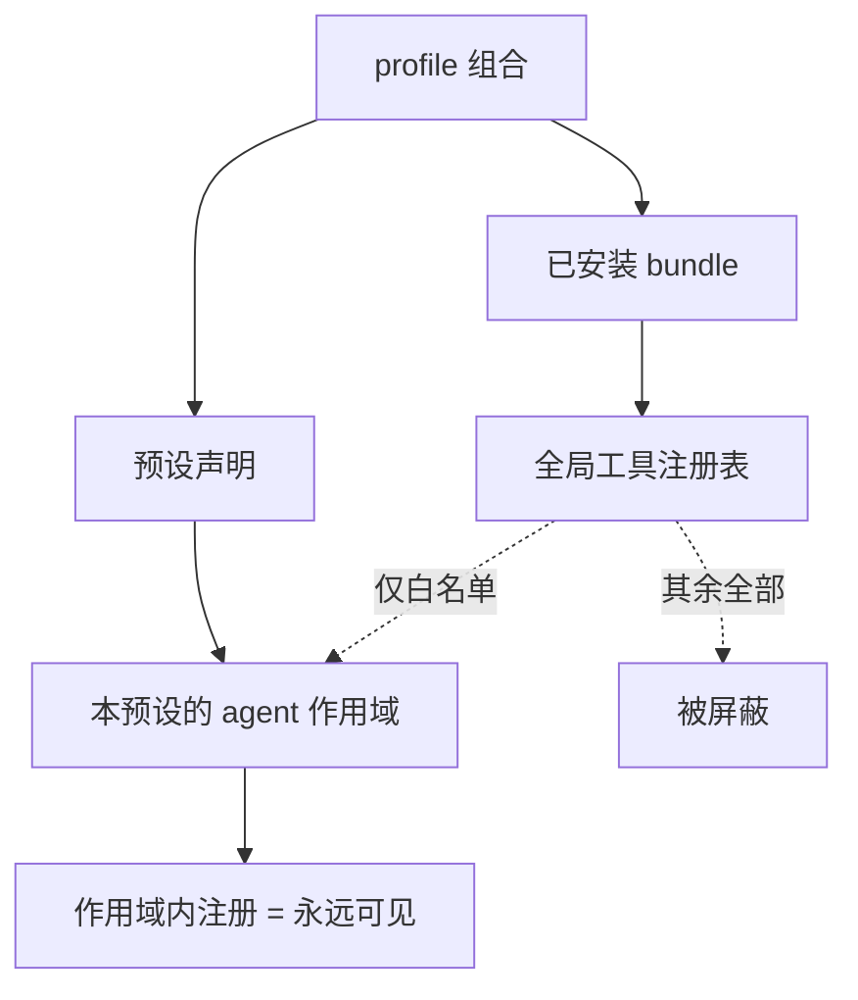
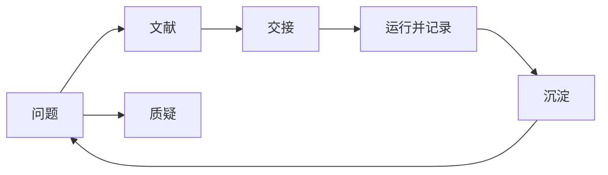

# Autoresearch 回顾 —— 这套东西到底是什么

> 这份是**给你回顾用**的中文一页纸。规范语义以 [`../protocol.md`](../protocol.md) 为准，名字索引在
> [`../surface.md`](../surface.md)。本文**不重复符号清单**——两处列同一批名字必然漂移。

## 一句话

**预设管「怎么研究」，工作区管「研究什么」。** 它约束证据如何被分类、主张如何被质疑、活怎么交给
子代理、实验如何被记录、进度如何沉淀；它对**研究内容**保持中立。

## 你的流程 → 谁负责 → 产物

| 你的步骤 | 负责的纪律 | 产物（角色，非路径） |
|---|---|---|
| 理解课题、收敛问题 | 收敛 | 一份可判定的问题书：问题/边界/非目标/可判定性/记号 |
| 搜参考文献 | 文献 + 元数据 + 两条外部通道 | 文献重建笔记（非规范）+ 元数据行 |
| 思维碰撞、质疑 | 质疑 | 裁定请求：反例/矛盾证据/证伪路径，或诚实地说"无法质疑" |
| 开子 agent 探索 / 写代码 | 交接 | 子代理报告**文件** + 父代理**自己重新导出**后才成为事实 |
| **综合成可执行稿** | **综合（新）** | 选定路径 + 赢得判据 + 被否决项及理由 + **验收标准（含失败条件）** + 第一步 + 风险与回退 + 预算 |
| 跑实验验证 | 运行 | 实验卡：假设/命令/配置与种子/产物/事实/解读/有效性/裁决 |
| 交流汇报、判断可行性 | 沉淀 | mnemon 结论 + 被否决方向及原因 + 逐轮日志 |
| 记录踩过的坑 | 沉淀（去向规则） | 按症状索引的坑文件，带适用环境与日期，作废即删 |

## 两张图

**① 工具可见性与隔离**（这是"不漏进来也不漏出去"的结构）



**② 研究闭环**



## 三个"看哪里"

| 我想知道… | 看哪 |
|---|---|
| 它**保证**什么、拒绝什么、边界在哪 | [`protocol.md`](../protocol.md)（normative） |
| 某个概念**对应哪个名字** | [`surface.md`](../surface.md)（non-normative） |
| 怎么装、怎么开发、有哪些已知约束 | [`README.md`](../README.md) |
| 当初**为什么**这么做、否掉了什么 | [`01_decisions.md`](01_decisions.md) |
| 当时的原始过程（含我犯的错） | [`archive/PLAN.md`](archive/PLAN.md)（冻结，不再维护） |

## 现状怎么查（不写死在文档里）

规模类数字（几行、几条纪律、常驻多少 token）**故意不写进本文**——它们会过时。要当前值就跑：

```powershell
dsh --profile web --dump-config > .tmp\composed-web.txt
node tools\preset-selftest.mjs .tmp\composed-web.txt   # 结构 + 纪律数 + 路由数 + 常驻成本
node tools\isolation-selftest.mjs                      # 隔离白名单语义
node tools\doc-selftest.mjs                            # 契约/索引 的分工是否还成立
```

## 一条最容易被误解的设计

**屏蔽是"保留制"而不是"拉黑制"。** 白名单里没列到的全局工具一律不可见——所以将来装任何新插件，
它的工具都**不会**自动溜进这个预设。这是刻意的：拉黑制会随着新插件出现而失效。
