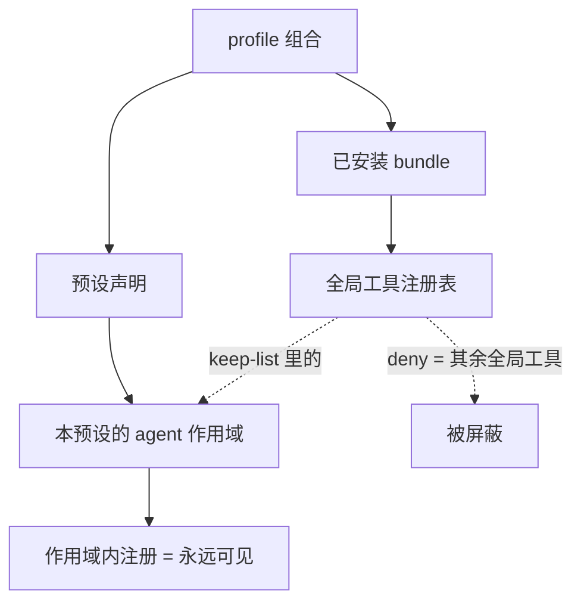
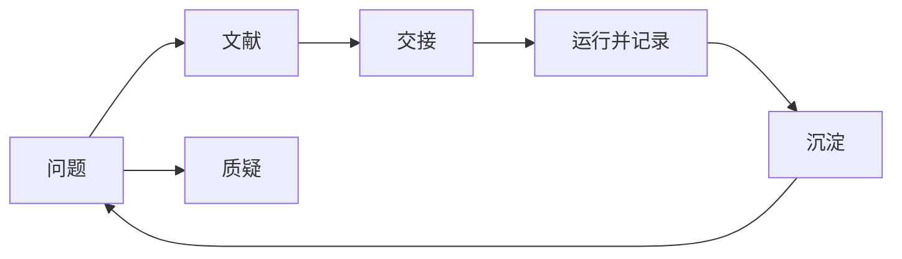

# Autoresearch 回顾 —— 这套东西到底是什么

> 这份是**给你回顾用**的中文一页纸。规范语义以 [`../protocol.md`](../protocol.md) 为准，名字索引在
> [`../surface.md`](../surface.md)。本文**不重复符号清单**——两处列同一批名字必然漂移。

## 一句话

**预设管「怎么研究」，工作区管「研究什么」。** 它约束证据如何被分类、主张如何被质疑、活怎么交给
子代理、实验如何被记录、进度如何沉淀；它对**研究内容**保持中立。

## 你的流程 → 谁负责 → 产物

| 你的步骤 | 负责的纪律 | 产物（角色，非路径） |
|---|---|---|
| 理解课题、收敛问题 | 收敛 | 一份可判定的问题书：问题/边界/非目标/可判定性/记号 |
| 搜参考文献 | 文献 + 元数据 + 两条外部通道 | 文献重建笔记（非规范）+ 元数据行 |
| 思维碰撞、质疑 | 质疑 | 裁定请求：反例/矛盾证据/证伪路径，或诚实地说"无法质疑" |
| 开子 agent 探索 / 写代码 | 交接 | 子代理报告**文件** + 父代理**自己重新导出**后才成为事实 |
| **综合成可执行稿** | **综合（新）** | 选定路径 + 赢得判据 + 被否决项及理由 + **验收标准（含失败条件）** + 第一步 + 风险与回退 + 预算 |
| 跑实验验证 | 运行 | 实验卡：假设/命令/配置与种子/产物/事实/解读/有效性/裁决 |
| 交流汇报、判断可行性 | 沉淀 | mnemon 结论 + 被否决方向及原因 + 逐轮日志 |
| 记录踩过的坑 | 沉淀（去向规则） | 按症状索引的坑文件，带适用环境与日期，作废即删 |

**库内空间与“能不能搜到全文”是同一件事的两面**。把库里“存储型附件”转成链接附件（增量走 CLI，存量走 in-app snippet，命令见 [`../README.md`](../README.md) 的 Configure it）不属于研究闭环，但它决定 agent 能搜到什么：**链接附件同样进全文索引**，而被删的存储副本要**清空回收站**才真正释放空间。
## 两张图

**① 工具可见性与隔离**（这是"不漏进来也不漏出去"的结构）



**② 研究闭环**



## 三个"看哪里"

| 我想知道… | 看哪 |
|---|---|
| 它**保证**什么、拒绝什么、边界在哪 | [`protocol.md`](../protocol.md)（normative） |
| 某个概念**对应哪个名字** | [`surface.md`](../surface.md)（non-normative） |
| 怎么装、怎么开发、有哪些已知约束 | [`README.md`](../README.md) |
| 当初**为什么**这么做、否掉了什么 | [`01_decisions.md`](01_decisions.md) |
| 当时的原始过程（含我犯的错） | [`archive/PLAN.md`](archive/PLAN.md)（冻结，不再维护） |

## 现状怎么查（不写死在文档里）

规模类数字（几行、几条纪律、常驻多少 token）**故意不写进本文**——它们会过时。要当前值就跑：

```powershell
dsh --profile web --dump-config > .tmp\composed-web.txt
node tools\preset-selftest.mjs .tmp\composed-web.txt   # 结构 + 纪律数 + 路由数 + 常驻成本 + 两条通道的反向护栏
node tools\isolation-selftest.mjs                      # 隔离的 deny 语义（不是白名单）
node tools\skills-selftest.mjs                         # 纪律随包注册 + helper 路径占位符是否被替换
node tools\contact-bridge-selftest.mjs                 # 可配置值 → 系统提示（含常驻的 helper 目录与写入门禁）
node tools\doc-selftest.mjs                            # 契约/索引 的分工是否还成立
node tools\arxiv-selftest.mjs                          # 预印本 helper：查询 url / Atom 解析 / 错误 feed（不出网）
node tools\zotero-read-selftest.mjs                    # 参考库读取：命中折叠 / 年份 / 附件挑选 / 切片（不连库）
node tools\zotero-edit-selftest.mjs                    # 条目编辑：字段白名单 / 标签整表 / 无变化即不写（不连库）
node tools\zotero-collection-selftest.mjs              # 分类：同级重名判定 / 归档整表（不连库）
node tools\zotero-note-selftest.mjs                    # 笔记：哪条是我们的 / 追加不覆盖（不连库）
node tools\zotero-link-selftest.mjs                    # 附件链接：文件名清洗 / 目标路径 / 冲突分类（不连库）
node tools\zotero-local-api-selftest.mjs               # 共享层：写入成功判据（任何 2xx）/ 未 open 不许写（不连库）
node tools\dump-session-selftest.mjs                   # 会话转写：扫描会下潜到会话目录 / 报的是实际跑的预设
```

## 一条最容易被误解的设计

**屏蔽是"拉黑制"，不是"保留制"。** 过滤写成 `deny =（全局视图 − keep-list）`，而不是"只保留白名单里列出的"。原因是语义级的：`restrict()` 过滤的是**该作用域继承来的东西**，而预设自己声明的行对 agent 而言是**祖先层贡献**——若用白名单只列全局工具，会把预设自己的 shell、文件与 skill 工具一并屏蔽掉（症状就是"agent 没有 shell"）。所以将来装任何新插件，它的工具是否可见取决于它是否落在 keep-list 里：不在 keep-list 的全局工具一律 deny，无需逐个登记。

三条边界必须一起记住：

1. 这个保证是**工具层面**的：**激活时那一遍是保证**，`tools/change`（注册表宣布"工具集变了"）那一遍负责补**晚注册**的插件——实测晚注册的 config-manager 5 个工具是**逐个注册、逐个被挡下**的，`config_restore` 在其中，而激活那遍根本算不到它们（[`01_decisions.md`](01_decisions.md) §33）。该遍只在 deny 集合真的变化时才施加。
2. **skill 目录不受此机制保护**——注册表不提供限制调用，profile 里别的 bundle 的 skill 会一起出现在本预设的目录里；预设只能靠常驻纪律说明"目录里但不在路由表里的条目怎么对待"。
3. 反过来，**预设自己行注册的工具永远屏蔽不掉**——包括它自带的**写工具**。所以参考库的写入门禁不能靠隔离，只能由契约（`INV-EVID-3`／§9）与常驻纪律承担；授权的粒度是**库**：首次写入由所有者在参考管理器对话框里授予，`Always Allow` 由工具按 `Zotero-Server-ID` 保存、可随时撤销（契约 Revision 10），见 [`01_decisions.md`](01_decisions.md) §31 与 §35。
