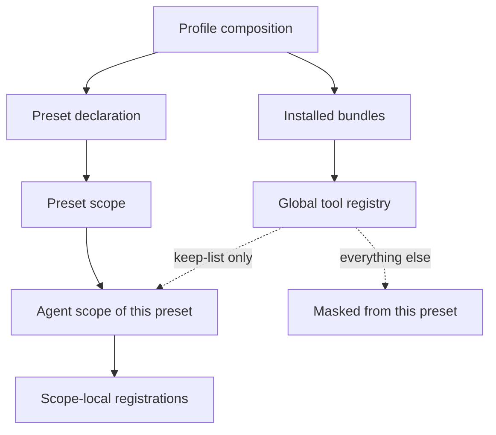
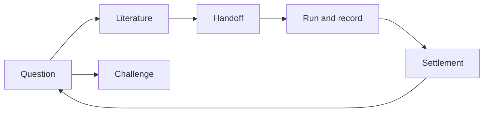

# Autoresearch protocol — what the research preset guarantees, and where its boundary is

**Status: normative. Revision 3.** This file is the contract of the Autoresearch preset. Where it
conflicts with the implementation — the composition file, the isolation plugin, the discipline
texts — **this file wins**, and the implementation must be corrected. The revision number is
independent of any package version. Revision 3 recorded a second, best-effort pass applied on every agent creation for plugins that register after the preset activates, and narrowed the guarantee to activation-time coverage, because that pass has not been confirmed to take effect at runtime. Revision 2 corrected the tool-isolation section: the filter is a deny list over the global view, because a restriction also filters ancestor contributions — the preset's own rows — and an allow list therefore masked the preset's own tools. The concept-to-name index is [`surface.md`](surface.md).

## 1. Notation and units

This contract involves no physical units. Every quantity below is a count, a name, a path, or a
boolean state.

| Term | Meaning |
|---|---|
| **Preset** | A named, selectable composition that defines one agent's identity, tools and discipline. |
| **Bundle** | An installable package that contributes rows to a profile. |
| **Row** | One entry in a composition: a plugin plus its configuration. |
| **Profile** | The composition a running harness boots: bundles, then user overrides. |
| **Global tool** | A tool registered by a profile-level plugin. Visible to every session unless masked. |
| **Scope-local tool** | A tool registered by a row the preset itself declares. Visible to that preset's agents, and unaffected by masking. |
| **Keep-list** | The explicit set of global tools a preset chooses to retain. |
| **Discipline** | A written rule set that constrains how research is conducted. Resident disciplines are always in force; on-demand disciplines are loaded when their trigger is met. |
| **Three-way typing** | The obligation to mark every statement as evidence-backed, an inference, or undecided. |
| **Handoff** | Delegating a deliverable to a subagent, and receiving it back. |
| **Run** | One execution of code intended to test a hypothesis. |
| **Card** | The record of one run: prediction, command, configuration, artifacts, observation, validity, verdict. |
| **Study** | One research project, living in its own workspace with its own conventions. |
| **Scaffold** | The default layout and instruction file the preset offers a new study. |

## 2. The chain, and where the boundary is

The system separates three layers, and the boundary between them is the whole design.





- **The preset owns how research is conducted**: identity, resident discipline, which disciplines
  exist, which tools are visible, and how evidence and progress are recorded. It is domain-neutral
  and must remain so.
- **The study owns what is researched**: its question, its invariants, its document hierarchy, its
  data and its code. These live in the study's workspace, not in the preset.
- **An existing study hierarchy outranks the scaffold.** Where a study already defines where its
  documents live and which of them are normative, the preset follows it and creates nothing
  parallel. The scaffold is a default for studies that have no convention yet.
- **Nothing of the preset lives at profile level.** A row mounted at profile level is visible to
  every unrelated session in the profile, which is the leak this contract forbids in both
  directions.

## 3. The resident discipline

The resident discipline is part of every request. It is small on purpose, and every rule in it must
be **decidable**: a reader must be able to say whether it was violated.

```text
1  three-way typing          fact | inference | exploratory, on every statement
2  no unfalsifiable wording  no "study further", "promising", "many studies show"
3  no citations from memory  every source actually read, with a path or an identifier
4  read before writing       survey first; follow an existing hierarchy
5  three kinds of "nothing"  not searched | searched and absent | not yet searched
6  decisions belong to the user
7  no silent contract change  revision + reason, or request a ruling
8  no exceeding the mandate
9  a subagent report is evidence, not a fact
```

```text
fact          the artifact says X, at this path, read this way
inference     my reading of it, together with the reasoning chain
[exploratory] a hunch with no run behind it
```

Rules 3 and 9 are the same idea at two scales: nothing enters the record because it was said.
Rule 9 exists because a handoff is where an unchecked claim most easily becomes the parent's own
voice.

The resident discipline also carries **routing**: each on-demand discipline states the situation
that triggers it. Routing is a hard rule, not a suggestion — a trigger that is met without the
discipline being loaded is a violation.

## 4. Disciplines loaded on demand

Each on-demand discipline is a written contract with fixed sections: when to use, the ruler to read
first, criteria, local exclusion conditions, wording discipline, report shape, instrument
discipline, an acceptance checklist, and what it does not do. The **local exclusion conditions** are
the load-bearing part: they say when to stop rather than to make something work.

```text
scoping      a vague topic becomes a decidable question; pseudo-questions are sent back
literature   sources are graded by what was actually read; contradicting evidence is mandatory
challenge    a claim is opposed with a counterexample, contradicting evidence, or a
             falsification path — or the challenge reports that it cannot challenge
settlement   conclusions, rejected directions and rulings are settled into three layers
metadata     bibliographic records come from a REST source; metadata is never evidence
handoff      a delegated deliverable is fixed before spawning; a child's conclusion is
             unverified until the parent reads the artifact
run          a hypothesis becomes a card; "ran" is not "valid"
synthesis    several explored directions become one executable draft: the choice, the criteria
             it won on, the rejected alternatives and their grounds, and the acceptance
             criterion that would refute it
```

Two invariants follow from the shape of these contracts:

- A discipline that cannot name a **local exclusion condition** is decorative.
- A discipline that cannot state its **artifact shape** produces prose, not evidence.

## 5. Tool visibility and isolation

An agent of this preset sees exactly two groups of tools:

```text
visible = (tools registered by rows this preset declares)      # the preset's own
        ∪ (global tools named in the keep-list)                # explicitly retained
```

```json
{ "deny": ["<global tool names the preset does NOT retain>"] }
```

The filter is expressed as a **deny list over the current global view**, not as an allow list, and that
is a correctness requirement rather than a style choice:

- A restriction filters what a scope **inherits** — the global layer and every ancestor layer on its
  chain — and never what that scope's **own** layer registers. For an agent, the preset's own rows are
  an **ancestor contribution**, so an allow list naming only global tools also masks every tool the
  preset declares itself: the agent ends up with no shell and no file tools.
- The deny list is `(every name in the global view) − keep-list`, and it removes exactly the
  globals outside the keep-list without touching the preset's own tools. **The guarantee is
  activation-time coverage.**
- A second pass also runs on every agent creation, where the global view is complete, as a
  **best-effort** measure against a plugin that registers late. It is deliberately **not** part of
  the guarantee: it depends on the event reaching a listener registered in the preset's own scope,
  and that has not been confirmed at runtime.

The filter is applied only when there is something to deny. It is applied at preset activation — the
guarantee — and again on every agent creation as a best-effort second pass:

```text
at preset activation:    deny = { n ∈ global view : n ∉ keep-list }   # the guarantee
at every agent creation: deny = { n ∈ global view : n ∉ keep-list }   # best effort, unverified
restrictions intersect, so the two passes compose; an empty pass is skipped
```

This is a deliberate failure mode. A filter naming an unregistered or scope-local tool is rejected by
the registry, so a keep-list copied naively would take the whole preset down. Building the filter from
the registry's own global view means it can contain neither, and a renamed or absent keep-list entry
degrades the isolation instead of breaking the preset — reported, not silent.

The keep-list exists because the preset's own disciplines depend on some global tools. The memory
disciplines are the clearest case: the settlement discipline records conclusions and rejected
directions through them, so masking them would leave a written discipline with no instrument.

## 6. External evidence channels

The preset reaches literature through three kinds of channel, and they are not interchangeable:

```text
preprint index        search and full text of preprints; no credentials
local reference lib   the study owner's own library, including full text of paywalled works
bibliographic REST    identifiers, venues, years, counts — metadata only, never evidence
```

Two rules bound their use:

- **Full text and metadata are different evidence classes.** A record obtained from a bibliographic
  REST source can never be the strongest grade; only text actually read can.
- **A channel that answers `HTTP/1.0` or rate-limits without a credential must be handled as a
  known constraint**, not retried in a loop. Rate limiting is a finding about the channel.

The channels are reached through the preset's own rows, never through a profile-level mount, so that
enabling a research channel cannot change what an unrelated session can do.

## 7. The study scaffold

The scaffold offers a study the minimum it needs to be auditable. Roles, not just paths:

```text
<study>/
  AGENTS.md            domain constraints: invariants, authority order, notation, environment
  research/
    00_scoping.md      question, boundary, non-goals, decidability
    literature/        reconstruction notes — non-normative by construction
    literature/refs/   the digest index: one line per reference actually read
    rulings/           challenges and the rulings on them
    journal/           the round-by-round record; never a conclusion
    experiments/       run cards; re-runnable evidence
    pitfalls/          symptom-indexed operational record; pruned when obsolete
  .agents/skills/      study-level discipline, if the domain needs one
```

The authority order is part of the contract: domain constraints outrank the scoping document, which
outranks non-normative notes; a journal is a record and never grounds a claim; a pitfall entry
carries the environment and date it applies to, so it can be deleted when it stops applying.

## 8. Domain invariants

Every row must be falsifiable: a check must exist that can fail.

| ID | Invariant | Why it is semantic |
|---|---|---|
| `INV-SCOPE-1` | An agent of this preset can call exactly the tools its own rows register, plus the global tools in the keep-list. | It defines the surface: what a research agent can do at all. |
| `INV-SCOPE-2` | A tool registered by a row the preset declares is never hidden by masking. | Otherwise the preset could hide its own capabilities, making the contract self-contradictory. |
| `INV-SCOPE-3` | When the keep-list intersects the global registry to nothing, masking is not applied and the omission is reported. | The failure mode must be "no isolation, loudly", never "the preset does not load". |
| `INV-SCOPE-4` | No row of this preset is mounted at profile level. | A profile-level mount leaks into every unrelated session, in both directions. |
| `INV-DISC-1` | Every resident rule is decidable by a reader. | An undecidable rule cannot be enforced, so it is decorative. |
| `INV-DISC-2` | Every statement is classed as evidence-backed, inference, or undecided, and is presented as no more than its class. | This is what separates a research record from a plausible narrative. |
| `INV-DISC-3` | A delegated conclusion is not the parent's fact until the parent has read the artifact itself. | Verification and attribution must not collapse into one act. |
| `INV-EVID-1` | A run with no artifact path is not reportable. | Reproducibility is the only property that makes a run evidence. |
| `INV-EVID-2` | A read-only input is never mutated, and a negative result is never deleted. | Both preserve the meaning of results already published. |
| `INV-EVID-3` | A write into the reference library happens only after the owner authorizes that specific write, and is reported only after a read-back matches what was sent. | The library is the owner's curated evidence base; an unauthorized or unverified write corrupts the very thing the preset depends on. |
| `INV-EVID-4` | A source already read at full-text grade is not read again to recover what it said; the digest is the record of that reading. | Re-reading is the dominant avoidable cost of a literature round, and a digest is what makes one reading reusable. |
| `INV-CTX-1` | A full text is loaded only after the cheaper levels of the reading ladder cannot answer the question. | Context is the scarce resource of a research session; loading it is a spending decision, not a default. |
| `INV-DEC-1` | A commitment is preceded by an executable draft that names the criteria it won on and the observation that would refute it. | A choice without criteria and without a failure condition cannot be re-examined when it fails. |
| `INV-PROJ-1` | An existing study hierarchy outranks the scaffold's default layout. | The preset is domain-neutral; a study's conventions carry its meaning. |
| `INV-DOC-1` | The contract names no public symbol, and the index is a bijection with the authoritative list. | It keeps the contract stable under renames and stops the index drifting from reality. |

## 9. Outside this domain (non-goals)

- No resident, self-organizing band of agents with consensus voting. The preset is a workbench, not
  a research group simulation.
- No automatic experiment orchestration: the preset provides the record, not a scheduler.
- No unattended write-back into the reference library. A write happens only under a per-write
  authorization from the owner, never as a background, bulk, or assumed-standing action.
- No version control of the study workspace, and no opinion about it.
- No domain-specific rule. Domain invariants belong to the study.
- No cost, schedule, or resource optimization.
- No direction-divergence loop. Generating several mutually distinct directions and killing them on
  explicit criteria is deliberately deferred; the scoping discipline currently offers candidates but
  not a cull.
- No claim about the truth of any study's conclusion. The preset constrains how conclusions are
  reached and recorded, and nothing more.
