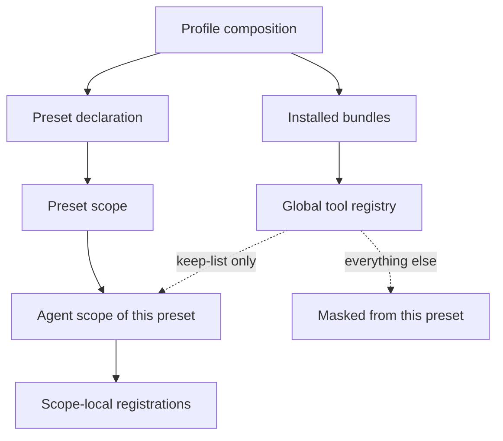
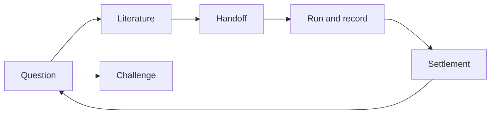

# Autoresearch protocol — what the research preset guarantees, and where its boundary is

**Status: normative. Revision 10.** This file is the contract of the Autoresearch preset. Where it
conflicts with the implementation — the composition file, the isolation plugin, the discipline
texts — **this file wins**, and the implementation must be corrected. The revision number is
independent of any package version. Revision 10 records what authorizes a write into the reference
library. The reference manager raises its dialog on every request for a key — the local API has no
"this application is already trusted" path, so the answer "Always Allow" chooses the kind of key issued
and never whether the owner is asked again — and this preset then discarded that lasting key when the
process ended, so every run asked again. Measured on the owner's own profile: one helper's 26 lasting
authorizations were 26 dialogs, 25 of them after the first "Always Allow". What was wrong was the
discard, not the dialog. Revision 10 therefore records that a key the owner chose to make lasting is
kept, partitioned by the server id it was granted for; that "Allow" covers exactly one write and is
never written down; that a revocation reaches the tools as a rejected key and is answered by asking
again; and it restates §5, §6, §8 and §9 accordingly, superseding the "per-write authorization" wording
of Revision 7. Revision 9 records how the filter covers a plugin that registers
after the preset activates: it is re-applied on every `tools/change`, the registry's own announcement
that the available tool set changed. The pass it replaces listened on `agent/created`, which — measured
against a real session — never reached this preset's row at all, so five tools of the configuration
bundle, one of them destructive, were reachable by every agent of this preset. §5 and its coverage
block state the mechanism as it now is. Revision 8 records that the preset mounts **no MCP server at all**:
both external channels are helper programs its own disciplines name, so a channel nobody uses costs
nothing, and the surface an agent sees is no longer a function of someone else's tool list. It corrects
§6 on two points — the preprint channel carries search and records rather than full text, and the
channels are reached through the preset's own helpers rather than through rows — and it narrows §5's
example accordingly, since the capability it bounds is now shipped as a program rather than registered
as a tool. Revision 7 adds `INV-HELPER-1`: a path this preset hands an agent
for its own helper programs must resolve from the agent's working directory, because a study workspace
carries no copy of them and a path relative to this repository therefore names nothing there. It also
records that the reference-library channel now serves write-capable tools; their use stays bounded by
`INV-EVID-3`'s per-write authorization and by a resident policy line rather than by masking, because §5
shows that a tool a row of this preset registers cannot be hidden. Revision 6 records two resident rules added for failure modes
observed in the field — an absence claim must carry the targeted check, the scope and the hit count
that make it an absence, and a number that follows from how an object was constructed is not a
measurement — together with a re-anchoring rule that keeps the round's original request visible; it
also states the exact scope of the isolation guarantee in §5 as **tools only**, because the skill
catalog merges every layer and the registry exposes no restriction call for it. Revision 5 records the owner's local reference library as a **full-text channel** and not a title index: a library searched only through bibliographic metadata reports an absence that is not an absence for the paywalled work it already holds. Revision 4 added `INV-ROW-1`, which requires every row name this preset declares to resolve through the host's module resolver from the profile's base URL: a package that declares `exports` seals its own subpaths, so a subpath the map omits makes the whole preset unusable while the file sits on disk. Revision 3 recorded a second, best-effort pass applied on every agent creation for plugins that register after the preset activates, and narrowed the guarantee to activation-time coverage, because that pass has not been confirmed to take effect at runtime; Revision 9 supersedes it, having measured both that the pass never ran and which event actually reaches this preset's row. Revision 2 corrected the tool-isolation section: the filter is a deny list over the global view, because a restriction also filters ancestor contributions — the preset's own rows — and an allow list therefore masked the preset's own tools. The concept-to-name index is [`surface.md`](surface.md).

## 1. Notation and units

This contract involves no physical units. Every quantity below is a count, a name, a path, or a
boolean state.

| Term | Meaning |
|---|---|
| **Preset** | A named, selectable composition that defines one agent's identity, tools and discipline. |
| **Bundle** | An installable package that contributes rows to a profile. |
| **Row** | One entry in a composition: a plugin plus its configuration. |
| **Profile** | The composition a running harness boots: bundles, then user overrides. |
| **Global tool** | A tool registered by a profile-level plugin. Visible to every session unless masked. |
| **Scope-local tool** | A tool registered by a row the preset itself declares. Visible to that preset's agents, and unaffected by masking. |
| **Keep-list** | The explicit set of global tools a preset chooses to retain. |
| **Discipline** | A written rule set that constrains how research is conducted. Resident disciplines are always in force; on-demand disciplines are loaded when their trigger is met. |
| **Three-way typing** | The obligation to mark every statement as evidence-backed, an inference, or undecided. |
| **Handoff** | Delegating a deliverable to a subagent, and receiving it back. |
| **Run** | One execution of code intended to test a hypothesis. |
| **Card** | The record of one run: prediction, command, configuration, artifacts, observation, validity, verdict. |
| **Study** | One research project, living in its own workspace with its own conventions. |
| **Scaffold** | The default layout and instruction file the preset offers a new study. |

## 2. The chain, and where the boundary is

The system separates three layers, and the boundary between them is the whole design.





- **The preset owns how research is conducted**: identity, resident discipline, which disciplines
  exist, which tools are visible, and how evidence and progress are recorded. It is domain-neutral
  and must remain so.
- **The study owns what is researched**: its question, its invariants, its document hierarchy, its
  data and its code. These live in the study's workspace, not in the preset.
- **An existing study hierarchy outranks the scaffold.** Where a study already defines where its
  documents live and which of them are normative, the preset follows it and creates nothing
  parallel. The scaffold is a default for studies that have no convention yet.
- **Nothing of the preset lives at profile level.** A row mounted at profile level is visible to
  every unrelated session in the profile, which is the leak this contract forbids in both
  directions.

## 3. The resident discipline

The resident discipline is part of every request. It is small on purpose, and every rule in it must
be **decidable**: a reader must be able to say whether it was violated.

```text
1  three-way typing          fact | inference | exploratory, on every statement
2  no unfalsifiable wording  no "study further", "promising", "many studies show"
3  no citations from memory  every source actually read, with a path or an identifier
4  read before writing       survey first; follow an existing hierarchy
5  three kinds of "nothing"  not searched | searched and absent | not yet searched; an absence
                             claim carries its targeted check, its scope and its hit count
6  decisions belong to the user
7  no silent contract change  revision + reason, or request a ruling
8  no exceeding the mandate
9  a subagent report is evidence, not a fact
10 a construction is not a   a number that follows from how the object was built is a property
   measurement               of the definition, not a finding
11 re-anchor to the request  the requested items are tracked as delivered or outstanding, and a
                             new branch names the outstanding item it serves
```

```text
fact          the artifact says X, at this path, read this way
inference     my reading of it, together with the reasoning chain
[exploratory] a hunch with no run behind it
```

Rules 3 and 9 are the same idea at two scales: nothing enters the record because it was said.
Rule 9 exists because a handoff is where an unchecked claim most easily becomes the parent's own
voice.

Rule 10 guards the opposite failure: a number that is exact and reproducible yet was never a
measurement, because it follows from how the object was built rather than from the world. Rule 11 is
the only rule aimed at the shape of a session rather than at a statement — it keeps a round's
original request visible, so that a chain of individually justified steps cannot quietly replace it.

The resident discipline also carries **routing**: each on-demand discipline states the situation
that triggers it. Routing is a hard rule, not a suggestion — a trigger that is met without the
discipline being loaded is a violation.

## 4. Disciplines loaded on demand

Each on-demand discipline is a written contract with fixed sections: when to use, the ruler to read
first, criteria, local exclusion conditions, wording discipline, report shape, instrument
discipline, an acceptance checklist, and what it does not do. The **local exclusion conditions** are
the load-bearing part: they say when to stop rather than to make something work.

```text
scoping      a vague topic becomes a decidable question; pseudo-questions are sent back
literature   sources are graded by what was actually read; contradicting evidence is mandatory
challenge    a claim is opposed with a counterexample, contradicting evidence, or a
             falsification path — or the challenge reports that it cannot challenge
settlement   conclusions, rejected directions and rulings are settled into three layers
metadata     bibliographic records come from a REST source; metadata is never evidence
handoff      a delegated deliverable is fixed before spawning; a child's conclusion is
             unverified until the parent reads the artifact
run          a hypothesis becomes a card; "ran" is not "valid"
synthesis    several explored directions become one executable draft: the choice, the criteria
             it won on, the rejected alternatives and their grounds, and the acceptance
             criterion that would refute it
```

Two invariants follow from the shape of these contracts:

- A discipline that cannot name a **local exclusion condition** is decorative.
- A discipline that cannot state its **artifact shape** produces prose, not evidence.

## 5. Tool visibility and isolation

An agent of this preset sees exactly two groups of tools:

```text
visible = (tools registered by rows this preset declares)      # the preset's own
        ∪ (global tools named in the keep-list)                # explicitly retained
```

```json
{ "deny": ["<global tool names the preset does NOT retain>"] }
```

The filter is expressed as a **deny list over the current global view**, not as an allow list, and that
is a correctness requirement rather than a style choice:

- A restriction filters what a scope **inherits** — the global layer and every ancestor layer on its
  chain — and never what that scope's **own** layer registers. For an agent, the preset's own rows are
  an **ancestor contribution**, so an allow list naming only global tools also masks every tool the
  preset declares itself: the agent ends up with no shell and no file tools.
- The deny list is `(every name in the global view) − keep-list`, and it removes exactly the
  globals outside the keep-list without touching the preset's own tools. **The guarantee is
  activation-time coverage.**
- A second pass runs on every `tools/change`: the registry announces a registration, an unregistration,
  or a change to a scoped restriction, and the filter is recomputed and re-applied. It covers a plugin
  that registers after the preset activates, which is the measured case — the configuration bundle
  reads the `tools` service, so its five tools appear afterwards, one registration at a time. That
  event is dispatched without scope filtering on purpose, which is what lets a listener here see it; a
  pass tied to a scope-filtered event did not, and the coverage it appeared to give did not exist.

The filter is applied only when there is something to deny. It is applied at preset activation — the
guarantee — and again whenever the registry announces that the tool set changed:

```text
at preset activation:   deny = { n ∈ global view : n ∉ keep-list }   # the guarantee
at a tools/change:      deny = { n ∈ global view : n ∉ keep-list }   # covers a late registration
restrictions intersect, so the passes compose; an unchanged set is not re-applied
```

This is a deliberate failure mode. A filter naming an unregistered or scope-local tool is rejected by
the registry, so a keep-list copied naively would take the whole preset down. Building the filter from
the registry's own global view means it can contain neither, and a renamed or absent keep-list entry
degrades the isolation instead of breaking the preset — reported, not silent.

The keep-list exists because the preset's own disciplines depend on some global tools. The memory
disciplines are the clearest case: the settlement discipline records conclusions and rejected
directions through them, so masking them would leave a written discipline with no instrument.

**The scope of this guarantee is tools, and the word is exact.** The skill catalog is not isolated by
any mechanism this preset can reach. A preset's own disciplines are registered into its own layer,
but a catalog read merges the global layer with the viewing scope's chain, and the skill registry
exposes no restriction call that a row could apply to it — so a profile carrying other bundles
contributes their skills to this preset's catalog as well. That is a boundary of the artifact rather
than a defect a row can correct, and the resident discipline states how an entry outside the routing
list is to be treated. Everything above about tool visibility is unaffected.

**A consequence of the same rule: a capability this preset ships cannot be masked.** Because masking
never reaches a tool registered by a row of this preset, a write-capable capability shipped by such a
row is reachable by every agent of this preset, and no restriction call can remove it — the filter is
the wrong instrument for that job and is not the one the contract relies on. The bound on such a
capability is the contract itself: a write into the reference library needs `INV-EVID-3`'s
authorization, which the owner grants in the reference manager's own dialog and can revoke there, §9
forbids an unattended or assumed one, and the preset states that policy in the agent's prompt rather
than depending on the capability's absence.

## 6. External evidence channels

The preset reaches literature through three kinds of channel, and they are not interchangeable:

```text
preprint index        search and records of preprints - metadata and abstracts; no credentials
local reference lib   the study owner's own library, searchable by attachment full text; includes the
                      full text of paywalled works
bibliographic REST    identifiers, venues, years, counts — metadata only, never evidence
```

Three rules bound their use:

- **Full text and metadata are different evidence classes.** A record obtained from a bibliographic
  REST source can never be the strongest grade; only text actually read can.
- **A channel that answers `HTTP/1.0` or rate-limits without a credential must be handled as a
  known constraint**, not retried in a loop. Rate limiting is a finding about the channel.
- **The owner's library is searched by full text, not only by metadata.** A library read as a title
  index turns work it already holds into a false absence, and that absence is a statement about the
  query rather than about the library.
- **The reference-library channel also carries writes, and they are bounded by the same gate.**
  Adding, editing, filing or removing a record is a write, so it needs `INV-EVID-3`'s authorization and
  its read-back before it is reported. The authorization is the reference manager's, not this preset's:
  "Allow" covers the one write and is spent by it, while "Always Allow" is a grant the tools keep for the
  library it was given for, so the owner answers once per library rather than once per write, and revokes
  it there when they want the asking back. A revoked grant reaches the tools as a rejected key, and they
  ask again rather than retry a credential they no longer hold. Which library operations exist is a
  property of the channel, not a permission.
- **A read must say which file it read.** Full text is keyed by an attachment rather than by the record,
  and a record may carry several, so a reading states which one answered and what was not read. A
  channel that returns an empty text for an unindexed attachment, or a failure as if it were a record,
  is reporting about itself rather than about the work.

The channels are reached through **helper programs this preset itself ships and its disciplines name**,
never through a profile-level mount, so that enabling a research channel cannot change what an unrelated
session can do. A channel is therefore not a set of tools the harness registers on the preset's behalf:
it is a program the agent runs, which is why an unused channel costs nothing on a request.

## 7. The study scaffold

The scaffold offers a study the minimum it needs to be auditable. Roles, not just paths:

```text
<study>/
  AGENTS.md            domain constraints: invariants, authority order, notation, environment
  research/
    00_scoping.md      question, boundary, non-goals, decidability
    literature/        reconstruction notes — non-normative by construction
    literature/refs/   the digest index: one line per reference actually read
    rulings/           challenges and the rulings on them
    journal/           the round-by-round record; never a conclusion
    experiments/       run cards; re-runnable evidence
    pitfalls/          symptom-indexed operational record; pruned when obsolete
  .agents/skills/      study-level discipline, if the domain needs one
```

The authority order is part of the contract: domain constraints outrank the scoping document, which
outranks non-normative notes; a journal is a record and never grounds a claim; a pitfall entry
carries the environment and date it applies to, so it can be deleted when it stops applying.

## 8. Domain invariants

Every row must be falsifiable: a check must exist that can fail.

| ID | Invariant | Why it is semantic |
|---|---|---|
| `INV-SCOPE-1` | An agent of this preset can call exactly the tools its own rows register, plus the global tools in the keep-list. | It defines the surface: what a research agent can do at all. |
| `INV-SCOPE-2` | A tool registered by a row the preset declares is never hidden by masking. | Otherwise the preset could hide its own capabilities, making the contract self-contradictory. |
| `INV-SCOPE-3` | When the keep-list intersects the global registry to nothing, masking is not applied and the omission is reported. | The failure mode must be "no isolation, loudly", never "the preset does not load". |
| `INV-SCOPE-4` | No row of this preset is mounted at profile level. | A profile-level mount leaks into every unrelated session, in both directions. |
| `INV-ROW-1` | Every row name this preset declares resolves, through the host's module resolver and from the profile's base URL, to the module that row intends. | A name that resolves while the composition is built but not during the registry's trial mount marks the whole preset unusable, and the roster hides such a preset instead of reporting it. |
| `INV-HELPER-1` | Every path this preset gives an agent for one of its own helper programs resolves from the agent's working directory. | A study workspace carries no copy of those programs, so a path relative to this repository names nothing there: the discipline reads as actionable while the tool it names is unreachable. |
| `INV-DISC-1` | Every resident rule is decidable by a reader. | An undecidable rule cannot be enforced, so it is decorative. |
| `INV-DISC-2` | Every statement is classed as evidence-backed, inference, or undecided, and is presented as no more than its class. | This is what separates a research record from a plausible narrative. |
| `INV-DISC-3` | A delegated conclusion is not the parent's fact until the parent has read the artifact itself. | Verification and attribution must not collapse into one act. |
| `INV-EVID-1` | A run with no artifact path is not reportable. | Reproducibility is the only property that makes a run evidence. |
| `INV-EVID-2` | A read-only input is never mutated, and a negative result is never deleted. | Both preserve the meaning of results already published. |
| `INV-EVID-3` | A write into the reference library happens only under an authorization the owner granted for that library, and is reported only after a read-back matches what was sent. | The library is the owner's curated evidence base; an unauthorized or unverified write corrupts the very thing the preset depends on. |
| `INV-EVID-4` | A source already read at full-text grade is not read again to recover what it said; the digest is the record of that reading. | Re-reading is the dominant avoidable cost of a literature round, and a digest is what makes one reading reusable. |
| `INV-CTX-1` | A full text is loaded only after the cheaper levels of the reading ladder cannot answer the question. | Context is the scarce resource of a research session; loading it is a spending decision, not a default. |
| `INV-DEC-1` | A commitment is preceded by an executable draft that names the criteria it won on and the observation that would refute it. | A choice without criteria and without a failure condition cannot be re-examined when it fails. |
| `INV-PROJ-1` | An existing study hierarchy outranks the scaffold's default layout. | The preset is domain-neutral; a study's conventions carry its meaning. |
| `INV-DOC-1` | The contract names no public symbol, and the index is a bijection with the authoritative list. | It keeps the contract stable under renames and stops the index drifting from reality. |

## 9. Outside this domain (non-goals)

- No resident, self-organizing band of agents with consensus voting. The preset is a workbench, not
  a research group simulation.
- No automatic experiment orchestration: the preset provides the record, not a scheduler.
- No unattended write-back into the reference library: nothing writes while the owner is not the one who
  asked for it. A write happens only under an authorization they granted in the reference manager — the
  single write their "Allow" covers, or their standing grant for that library — never as a background
  action, and never on the strength of a grant that was refused or has been revoked. A whole-library
  migration is not a write this preset performs at all.
- No version control of the study workspace, and no opinion about it.
- No domain-specific rule. Domain invariants belong to the study.
- No cost, schedule, or resource optimization.
- No direction-divergence loop. Generating several mutually distinct directions and killing them on
  explicit criteria is deliberately deferred; the scoping discipline currently offers candidates but
  not a cull.
- No claim about the truth of any study's conclusion. The preset constrains how conclusions are
  reached and recorded, and nothing more.
