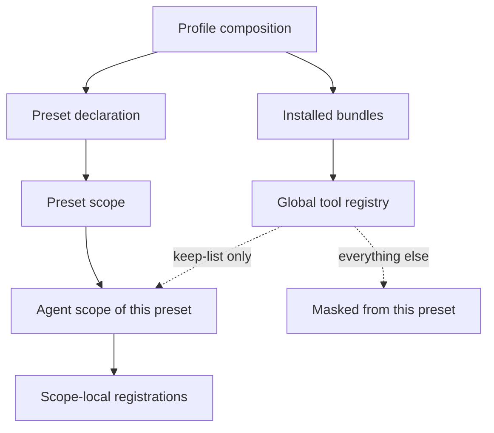
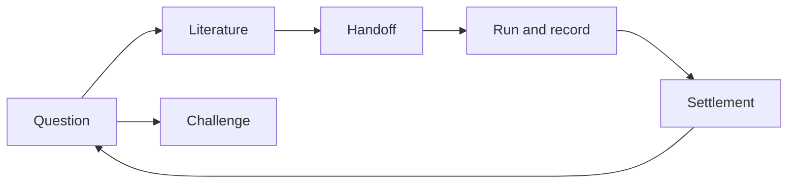

# Autoresearch protocol — what the research preset guarantees, and where its boundary is

**Status: normative. Revision 34.** This file is the contract of the Autoresearch preset. Where it
conflicts with the implementation — the composition file, the isolation plugin, the discipline
texts — **this file wins**, and the implementation must be corrected. The revision number is
independent of any package version. Revision 34 governs what a failure says. Every helper program now
fails through one renderer: the line that states what did not happen, and, when exactly one next action
is known, a line carrying it — plus a command only where that command works as printed. Nothing is added
where nothing is known, because a guessed remedy turns a retry into a drift, and a drifting round is the
one that leaves the channel. The remedy travels from the site that knows what the request meant rather
than from a reader of the text: the transport carries a status and names no remedy, so a 404 that means
"that key is not in this library" and a 404 that means "no such collection" are never confusable. It also
corrects two answers that were merely wrong: a record carrying no readable attachment is a refusal, not a
malformed command line, and naming neither a source nor a DOI is the command line's fault and not a
write's. §6 and `INV-FAIL-1` state it.
Revision 33 gives the reference-library channel the one thing it
did not have: a way back from "the library is not answering". That failure reached the caller as a
transport error, which names no next step and reads like a broken instrument — and an instrument that
looks broken is how a round talks itself into reading the library by another route. Two things follow.
A helper program now starts the reference manager when nothing answers and no process is running, and
reports which of four states it found; it launches nothing at an address `ZOTERO_LOCAL_API` names,
because that address belongs to a stub. And the channel states its own boundary: the library is read
through the application's own API, keyed by a record, so a round that cannot make it answer reports
that and stops rather than reading the database file or picking stored attachments out by path — a
reading that cannot name its record can be written onto nothing, matched against no note, and checked
by no reader. §6 and `INV-EVID-7` state it.
Revision 32 names the provenance this contract did not have: who
wrote a note's body. A section note the preset's own discipline writes carries `/agent-note`; the
owner's acceptance of that body is `/reviewed`; an unreviewed agent body is a draft that may be
rewritten in place and that supports a candidate and nothing stronger, while a reviewed one is a
record. An agent body never carries `/imported`, because that tag says the text came from outside and
an agent's draft did not. The same revision gives a write a third answer: exit 1 says nothing was
written, exit 0 says it was written and read back, and a write that may exist — the request failed,
or landed but did not read back — is reported as sent-but-unconfirmed and never as refused, because a
false "nothing was written" is how one note becomes two. That answer is the same for every write path
this preset has, not only for a note: a new record, a field or tag change, a collection, an attachment. It also removes the note-title attempt,
which this channel refuses (a note has no title field; a title patch answers 500), and states that a
create on a record carrying unclaimed notes is refused until those notes are read, since `covered:
none` says what claims a section and not what explains it. §6, §8 and the two disciplines state it.
Revision 31 names a rung Revision 17 shipped and its own paragraph
left out: the paper's own table of contents is rung 3 of the reading ladder, between the attachment's
text layer and the rendered page. The helper had already numbered it so, and two disciplines already
climb it, but §6 and `INV-CTX-1` listed three rungs — so a reader of the contract could not learn that
a structural read exists, and a discipline that named one looked unsupported. The same revision states
what §7's own layout block already contained: the draft directory is created up front with the
literature layer and the scoping document. It also makes moving a retired document into the archive
the owner's act rather than a round's, because the sentence assigned that move to no discipline, and it
records in §8 why one invariant id is missing from the sequence: a retired id is never reused. No
behaviour changes; every sentence here is what the helper programs and the shipped scaffold already
did.
Revision 30 removes the owner-action layer from §7's list, which no discipline has written since
Revision 26, and aligns four discipline texts and the coverage map with Revision 29's trigger: a note
body is generated only when the owner names that section. No behaviour changes — the contract already
said what they now say.
Revision 29 moves the **trigger** of the section-note discipline:
what starts a section note is the owner naming that section and asking for it, not the end of a method
section in a reading round. A note pasted in from outside is claimed to the section its own heading
names — a tag and no body — and a round that only claims reports the sections still carrying no note
instead of writing them. Two facts force it. A claim says that a section has an explanation attached,
never that this session read the paper, so a claim round writes no `depth` into a question's ledger. And
a wrong claim is permanent while a missing note is cheap: a claimed section is refused a second note,
and adoption cites a note rather than re-reading the source, so a claim made from a guess is not
correctable later. The claim path itself is not new — a pasted note has been claimed or rewritten in
place since Revision 17 — so what this revision changes is which round is the ordinary one. §4 states it.
Revision 28 states which file a reading fills, because the scaffold
and four disciplines had come to name different ones: the scaffold's `references/ledger.md` is the
table's **shape** and nothing else, and a question's ledger is `references/<topic>.md` — the file every
discipline names — which the first round creates by copying that shape. §7's layout note had read as if
a reading filled `ledger.md` itself, so a study scaffolded by Revision 26 and swept by Revision 27 would
have left the file the disciplines look for empty and the file it was given behind. §7 states it.
Revision 27 adds one on-demand discipline, because the step before
the reading round had none. The three steps around it existed — a source is graded by what was read, one
paper is advanced through for one named question, a note is written at a method section's end — and
nothing turned **a collection** into "these candidates, in this order, with the ones that cannot serve us
already ruled out". A collection was therefore read in whatever order the library listed it, or screened
by hand with nothing recorded, and the next round either re-screened it or opened a paper an earlier round
had already rejected. The discipline enumerates the collection, judges a handful of records at a time at
the abstract, writes one row per record in that question's own ledger — a ruled-out paper keeping a row
that names the abstract's own sentence and the condition that would reopen it — queues the rest with no
verdict, and hands that queue on in a stated order. It reads no paper, writes no library note, and decides
no adoption; it reuses the reading vocabulary rather than starting a second one, so `enough` is never
written from an abstract. The same revision records what its enumeration instrument measured, because both
facts change what a sweep may claim: the library honours an offset, so a collection larger than one page is
read rather than truncated, and a collection does **not** contain its subcollections' items, so a subtree
is swept one collection at a time. §4 states the discipline, and the row it writes is the one §7's
literature layer defines. Revision 26 shrinks the **study scaffold** to the one layer that two
real studies had independently defined the same way. The scaffold used to pre-create seven directories and
an authority table a study inherited; neither of the two studies this preset was measured against had used
any of them, and each had grown its own shape instead, so the template was stating a shape rather than a
minimum. What survives is the scoping document and one non-normative literature layer — the only layer
whose rules two independent studies wrote identically: pointers only, the grade the reading was given
copied and never refined, and no verdict about adoption. Every other layer is now created by the
discipline that first writes there, and that round names the path it used. The revision also stops
requiring the `research/` wrapper: a study's layer root is `research/` where that directory exists and the
study's own root where it does not, and a study carrying both is not silently adapted — it stops the round,
which asks which tree is the study's. The prefilled constraint file goes with them, because an authority
table is its owner's to write and a discipline that needs an invariant now says it is missing instead of
reading a placeholder. §7 states all of it. Revision 25 removes the **paper-level digest**. Every discipline
step that wrote one, the invariant that bounded it, and the helper that maintained it are gone: a
projection that introduces no fact its section notes do not carry adds a write per paper and answers
nothing a reader of those notes cannot answer, and this preset's own library had never produced one.
A note an earlier version tagged `/digest` is now **legacy**: nothing writes it, it is never coverage,
and it is recognized only so a whole-paper summary is not claimed for a section. The same revision
states the other direction of the same economy: the two ruling disciplines are on demand and are never
a step in reading, because a discipline that does not trigger is not in the request and costs nothing,
while a mandatory artifact costs every round. Revision 24 narrows one requirement of Revision 23 and
closes one gap it left. Revision 23 read as if **every** verdict carried a re-open condition, but requiring one
where the reading did reach the end of the paper produces filler, and a cell filled with "if we need
more" is worse than an empty one — so the condition is required for `park`, for `stop`, and for
`enough` reached **short of the full text**, and may stay empty only for `enough` at `depth: full`. The
gap: a study scaffolded before Revision 22 still carries `research/literature/refs/`, and Revision 22
abolished the directory without saying what happens to a copy that already exists. Nothing reads it;
the search round **reports it and does not delete it**, because removing a file from the owner's
workspace is not a reading round's act. §4 and §7 state both. Revision 23 adds one on-demand discipline, because two existing ones
each owned half of the same question. **How far a paper is worth reading** belonged to nobody: the
search round could only screen by abstract, before reading it, and the section-note round assumed the
paper had already been chosen for study — so "read to §2 and judged it irrelevant to this question" had
no legal exit and left no record, and every later round either re-read the paper or re-made the
judgement. The new discipline advances one paper section by section for **one named question**, records
the depth the reading reached and the verdict that stopped it in that question's own ledger, requires
the sentence that decided it and the condition that would reopen it, and reuses the section notes
another question already wrote rather than reading that paper again. It evaluates no paper's quality,
writes no library note, and its verdicts are `enough` and `stop` — never "unclear". §4 and §7 state it.
Revision 22 removes the **study-level reading receipt index**. A
study has several questions in flight, and one line per reference could say only that a paper had been
read — not for which question, nor how far — so a paper one question stopped at its third section and
another read to the end had one blurry row between them. How far a paper was read is now recorded in
**that question's own ledger**, inside the question's literature file: `depth` says where the reading
stopped, `verdict` says why, and `INV-EVID-4`'s judgement is made by reading that row and then the
record's notes rather than by looking up an index. A grade now measures the sentence it sits on and
never how much of the paper was read. The item's `/done` tag survives as a marker the owner may set,
and no decision reads it. §6 and §7 state it, and `INV-EVID-6` is added. Revision 21 lets the preset
erase a retired note: `--delete`
performs the `DELETE` it used to only plan, on a `/retired` note only, carrying the version it was
read at as a precondition, and proving it with a 404. Deletion is therefore a capability of the
preset now, bounded to one note at a time; it is still not a cleanup pass. The same revision keeps
the digest's previous body **in the reference library**: a refresh writes the old body once as a
`/digest` + `/retired` child note and then patches the live digest, rather than leaving the old body
in a workspace file. A section-note rewrite stops writing a workspace backup at all: the paper is
the source, the plan shows the old first block, and a version conflict is refused. §6, §8 and §9
state it. Revision 20 makes the digest a **projection of the section
notes**: one live `/digest` per record, synthesized from its `/section-N` notes rather than from the
raw paper, refreshed in place, and no longer a reading receipt —
the receipt is the question's own ledger row (Revision 22). Revision 19 moves a note's identity
out of the body: `/section-N`, `/imported`, `/digest`, `/retired` and `/replaces-KEY` are tags, no
invisible marker is written or read, a note with no `/section-` tag is **unknown** until it is read
and claimed, the mechanical prose repair is removed, and a pasted note may be rewritten in place
while a claimed record is still retired and replaced. §4, §6, §8 and §9 state it. Revision 18 gives
the third channel the program the other two
already had: the bibliographic REST channel is now reached through a helper this preset ships and its
discipline names, so §6's statement that the channels are reached through such programs holds for all
three rather than for two of them. It adds one rule to §6 — a bibliographic count is quoted with the
source that produced it and the date it was read, because the same work was measured carrying 43,412
citations on one source and 46,513 on the other — and corrects §6's own count of its rules, which said
three while carrying seven. §6 states it.
Revision 17 states three capabilities this contract previously
left without a channel, and corrects one reason it gave. A section a wrong note covers is freed by
**retiring** that note: the note's body is never touched, the mark that retires it is reversible, a
retired note stops counting as coverage, and the note that replaces it names the one it replaced, so
the record of why the section was written again survives though nothing was deleted. What this preset
asks the owner to remove is handed over as an artifact of fixed shape rather than as prose, because "a
list, not a capability" says what the preset will not do and nothing about what it will hand over, and
a round that has to invent that shape produces one no other round can merge. The reading ladder §8
already leaned on is named rung by rung — the library's indexed text, the attachment's own text layer,
and the page as an image — and a reading states which rung answered it, because an index that was never
built, a text layer whose font encoding is broken, and a page whose mathematics never became text are
three different failures that read alike in a transcript. It also corrects §9's reason for performing no
deletion, which is a property of this channel rather than of deletion as such. §6, §7, §8 and §9 state
it. Revision 16 parts what a run was predicted to do from what it
did, and requires the artifacts a record cites to stay obtainable. It records three things as contract
rather than leaving them to the scaffold's own text: the prediction is written **before** the run into
an artifact of its own, because a prediction that shares a file with its outcome cannot be told apart
from one written afterwards; the record of a run is added to and never repaired, so a run that failed
its own gate is recorded as invalid rather than quietly reworded; and an artifact a record cites must
be obtainable by the reader that record is written for — where a study's outputs live outside its own
record, that means a copy kept with it, and a citation nothing can retrieve is a defect stated on the
record rather than a line deleted from it. §1, §4, §7 and §8 state it. Revision 15 adds the tenth on-demand discipline: a paper the study
has read becomes a **ruled ledger of what it may lend**, one verdict per borrowable item, whose reader
is an implementer who never opens the paper. It records four things as contract rather than leaving them
to that discipline's own text — an item reaches code only with the paper's own locator, the condition it
holds under, our normalized form beside the paper's, and **a number a test can assert**, because a
formula copied correctly and a formula implemented differently are otherwise indistinguishable, so an
item without such an anchor stays a candidate; a verdict is the owner's and is dated, and an item is
verified only when that number passes; the ledger grounds no research conclusion, while a module that
disagrees with a ruled item is a defect rather than a difference of opinion; and one formula has one
transcription, so where a section note already holds it the ledger cites that note instead of deriving it
again. §4, §7, §8 and §9 state it. Revision 14 fixes the unit a section note is counted in, and says
who decides it: **coverage is counted per top-level section**, a section written as notes for its own
subsections is covered **in parts** and never also as a whole, and the reading that decides which
sections a record already covers is made by reading the notes — the channel reports the ones it can
read and names the ones it cannot, and a disagreement between the two readings stops the round instead
of being written around. §6 states it. Revision 13 bounds a digest write: a digest the record already
reads with is reported as already recorded and nothing is written, because a round that is re-run must
not turn one reading into the same sentence twice — and that comparison is made on the text a reader
sees rather than byte for byte, because the reference manager rewrites the body of a note its own
application has edited. §6 and `INV-EVID-4` state it. Revision 12 states the boundary this preset measured rather than
assumed: **at that revision it performed no deletion in the reference library.** Deleting through the library's local API is
permanent — measured 2026-10-16, a `204` and the record is a `404` afterwards, while the library's trash
neither grows nor holds the key — whereas the owner deleting in the application moves the item into that
trash and can be undone. The asymmetry is the point: what an agent cannot undo is not something an agent
should be able to do at scale, so removal stayed the owner's act and the preset handed over a list rather
than a button. Revision 21 later allowed one bounded erasure of a retired note; the same asymmetry is
why it is one note at a time and why the plan is separate from the act. §9 states it. Revision 11 adds the ninth on-demand discipline: a paper already
chosen for study becomes **one explanation note per method section**, attached to its reference-library
record, with background, case study and conclusion sections deliberately not written. It records three
things that discipline is built on rather than leaving them to its own text: the note is a different
artifact from the digest `INV-EVID-4` speaks of, and neither replaces the other; a section the record
already covers is never written twice, including coverage recorded only in a note's own opening line;
and repairing an older note's damaged formula delimiters is **mechanical only** — a repair that guesses
at what a broken formula meant is a rewrite, and a rewrite is not a repair. §4 and §6 are restated
accordingly. Revision 23 later moves that discipline's trigger from the paper's selection for study to the
end of a method section in a reading round, and Revision 29 moves it once more, to the owner naming that
section; §4 states the current one. Revision 10 records what
authorizes a write into the reference
library. The reference manager raises its dialog on every request for a key — the local API has no
"this application is already trusted" path, so the answer "Always Allow" chooses the kind of key issued
and never whether the owner is asked again — and this preset then discarded that lasting key when the
process ended, so every run asked again. Measured on the owner's own profile: one helper's 26 lasting
authorizations were 26 dialogs, 25 of them after the first "Always Allow". What was wrong was the
discard, not the dialog. Revision 10 therefore records that a key the owner chose to make lasting is
kept, partitioned by the server id it was granted for; that "Allow" covers exactly one write and is
never written down; that a revocation reaches the tools as a rejected key and is answered by asking
again; and it restates §5, §6, §8 and §9 accordingly, superseding the "per-write authorization" wording
of Revision 7. Revision 9 records how the filter covers a plugin that registers
after the preset activates: it is re-applied on every `tools/change`, the registry's own announcement
that the available tool set changed. The pass it replaces listened on `agent/created`, which — measured
against a real session — never reached this preset's row at all, so five tools of the configuration
bundle, one of them destructive, were reachable by every agent of this preset. §5 and its coverage
block state the mechanism as it now is. Revision 8 records that the preset mounts **no MCP server at all**:
both external channels are helper programs its own disciplines name — Revision 18 extends that to the
third — so a channel nobody uses costs
nothing, and the surface an agent sees is no longer a function of someone else's tool list. It corrects
§6 on two points — the preprint channel carries search and records rather than full text, and the
channels are reached through the preset's own helpers rather than through rows — and it narrows §5's
example accordingly, since the capability it bounds is now shipped as a program rather than registered
as a tool. Revision 7 adds `INV-HELPER-1`: a path this preset hands an agent
for its own helper programs must resolve from the agent's working directory, because a study workspace
carries no copy of them and a path relative to this repository therefore names nothing there. It also
records that the reference-library channel now serves write-capable tools; their use stays bounded by
`INV-EVID-3`'s per-write authorization and by a resident policy line rather than by masking, because §5
shows that a tool a row of this preset registers cannot be hidden. Revision 6 records two resident rules added for failure modes
observed in the field — an absence claim must carry the targeted check, the scope and the hit count
that make it an absence, and a number that follows from how an object was constructed is not a
measurement — together with a re-anchoring rule that keeps the round's original request visible; it
also states the exact scope of the isolation guarantee in §5 as **tools only**, because the skill
catalog merges every layer and the registry exposes no restriction call for it. Revision 5 records the owner's local reference library as a **full-text channel** and not a title index: a library searched only through bibliographic metadata reports an absence that is not an absence for the paywalled work it already holds. Revision 4 added `INV-ROW-1`, which requires every row name this preset declares to resolve through the host's module resolver from the profile's base URL: a package that declares `exports` seals its own subpaths, so a subpath the map omits makes the whole preset unusable while the file sits on disk. Revision 3 recorded a second, best-effort pass applied on every agent creation for plugins that register after the preset activates, and narrowed the guarantee to activation-time coverage, because that pass has not been confirmed to take effect at runtime; Revision 9 supersedes it, having measured both that the pass never ran and which event actually reaches this preset's row. Revision 2 corrected the tool-isolation section: the filter is a deny list over the global view, because a restriction also filters ancestor contributions — the preset's own rows — and an allow list therefore masked the preset's own tools. The concept-to-name index is [`surface.md`](surface.md).

## 1. Notation and units

This contract involves no physical units. Every quantity below is a count, a name, a path, or a
boolean state.

| Term | Meaning |
|---|---|
| **Preset** | A named, selectable composition that defines one agent's identity, tools and discipline. |
| **Bundle** | An installable package that contributes rows to a profile. |
| **Row** | One entry in a composition: a plugin plus its configuration. |
| **Profile** | The composition a running harness boots: bundles, then user overrides. |
| **Global tool** | A tool registered by a profile-level plugin. Visible to every session unless masked. |
| **Scope-local tool** | A tool registered by a row the preset itself declares. Visible to that preset's agents, and unaffected by masking. |
| **Keep-list** | The explicit set of global tools a preset chooses to retain. |
| **Discipline** | A written rule set that constrains how research is conducted. Resident disciplines are always in force; on-demand disciplines are loaded when their trigger is met. |
| **Three-way typing** | The obligation to mark every statement as evidence-backed, an inference, or undecided. |
| **Handoff** | Delegating a deliverable to a subagent, and receiving it back. |
| **Run** | One execution of code intended to test a hypothesis. |
| **Protocol** | What one run was declared to do before it ran: prediction, reference population, the closed variant set, validity gates, decision rule. Written before the run, never revised after it. |
| **Card** | The record of one run as it happened: command, configuration, artifacts, observation, validity, verdict. It cites its protocol rather than restating it. |
| **Study** | One research project, living in its own workspace with its own conventions. |
| **Scaffold** | The default layout and instruction file the preset offers a new study. |

## 2. The chain, and where the boundary is

The system separates three layers, and the boundary between them is the whole design.





- **The preset owns how research is conducted**: identity, resident discipline, which disciplines
  exist, which tools are visible, and how evidence and progress are recorded. It is domain-neutral
  and must remain so.
- **The study owns what is researched**: its question, its invariants, its document hierarchy, its
  data and its code. These live in the study's workspace, not in the preset.
- **An existing study hierarchy outranks the scaffold.** Where a study already defines where its
  documents live and which of them are normative, the preset follows it and creates nothing
  parallel. The scaffold is a default for studies that have no convention yet.
- **Nothing of the preset lives at profile level.** A row mounted at profile level is visible to
  every unrelated session in the profile, which is the leak this contract forbids in both
  directions.

## 3. The resident discipline

The resident discipline is part of every request. It is small on purpose, and every rule in it must
be **decidable**: a reader must be able to say whether it was violated.

```text
1  three-way typing          fact | inference | exploratory, on every statement
2  no unfalsifiable wording  no "study further", "promising", "many studies show"
3  no citations from memory  every source actually read, with a path or an identifier
4  read before writing       survey first; follow an existing hierarchy
5  three kinds of "nothing"  not searched | searched and absent | not yet searched; an absence
                             claim carries its targeted check, its scope and its hit count
6  decisions belong to the user
7  no silent contract change  revision + reason, or request a ruling
8  no exceeding the mandate
9  a subagent report is evidence, not a fact
10 a construction is not a   a number that follows from how the object was built is a property
   measurement               of the definition, not a finding
11 re-anchor to the request  the requested items are tracked as delivered or outstanding, and a
                             new branch names the outstanding item it serves
```

```text
fact          the artifact says X, at this path, read this way
inference     my reading of it, together with the reasoning chain
[exploratory] a hunch with no run behind it
```

Rules 3 and 9 are the same idea at two scales: nothing enters the record because it was said.
Rule 9 exists because a handoff is where an unchecked claim most easily becomes the parent's own
voice.

Rule 10 guards the opposite failure: a number that is exact and reproducible yet was never a
measurement, because it follows from how the object was built rather than from the world. Rule 11 is
the only rule aimed at the shape of a session rather than at a statement — it keeps a round's
original request visible, so that a chain of individually justified steps cannot quietly replace it.

The resident discipline also carries **routing**: each on-demand discipline states the situation
that triggers it. Routing is a hard rule, not a suggestion — a trigger that is met without the
discipline being loaded is a violation.

## 4. Disciplines loaded on demand

Each on-demand discipline is a written contract with fixed sections: when to use, the ruler to read
first, criteria, local exclusion conditions, wording discipline, report shape, instrument
discipline, an acceptance checklist, and what it does not do. The **local exclusion conditions** are
the load-bearing part: they say when to stop rather than to make something work.

```text
scoping      a vague topic becomes a decidable question; pseudo-questions are sent back
literature   sources are graded by what was actually read; contradicting evidence is mandatory
collection   one whole collection becomes a candidate queue for one named question: every record is
             enumerated, the ones an abstract already settles as unable to serve the question are
             ruled out and keep a row saying which sentence decided it, the rest are queued with no
             verdict, a row that already carries a current verdict is left alone, and nothing is
             claimed about a record's text from a missing abstract
triage       one paper is advanced section by section for one named question, and that question's
             own ledger records the depth the reading reached and the verdict that stopped it: a
             row is never deleted, `enough` and `stop` are different answers, a re-open condition is
             required for `park`, `stop` and every `enough` short of the full text, a verdict that
             would move the research direction is the owner's, and the reading reuses the section
             notes another question already wrote
sections     one `/section-N` note per TOP-LEVEL section, attached to its library record: it is
             written only when the owner names that section and asks for it, a note pasted in from
             outside is claimed to the section its own heading names — a tag, never a body — and a
             round that only claims reports the sections still carrying no note instead of writing
             them; background, case study and conclusion sections are not written, a claimed section
             is never written twice, a dotted key is neither written nor read, a pasted note is
             claimed or rewritten in place, a wrong record is retired rather than deleted, an
             agent-written body is tagged `/agent-note` until the owner accepts it with `/reviewed`,
             and one record carries one explanation per section and no paper-level summary
adoption     what a paper read may lend becomes a ruled ledger: the paper's own locator, the
             condition it holds under, our normalized form beside the paper's, the module it
             becomes, and the number a test can assert — the owner rules, nothing enters code
             without an anchor, an unreviewed agent note supports no adoption, and the ledger
             grounds no conclusion
challenge    a claim is opposed with a counterexample, contradicting evidence, or a
             falsification path — or the challenge reports that it cannot challenge
settlement   conclusions, rejected directions and rulings are settled into three layers
metadata     bibliographic records come from a REST source; metadata is never evidence
handoff      a delegated deliverable is fixed before spawning; a child's conclusion is
             unverified until the parent reads the artifact
run          a hypothesis is written down before it is tested, and the test becomes a card;
             "ran" is not "valid", and a card citing an artifact nobody can retrieve is not
             evidence
synthesis    several explored directions become one executable draft: the choice, the criteria
             it won on, the rejected alternatives and their grounds, and the acceptance
             criterion that would refute it
```

Two invariants follow from the shape of these contracts:

- A discipline that cannot name a **local exclusion condition** is decorative.
- A discipline that cannot state its **artifact shape** produces prose, not evidence.

## 5. Tool visibility and isolation

An agent of this preset sees exactly two groups of tools:

```text
visible = (tools registered by rows this preset declares)      # the preset's own
        ∪ (global tools named in the keep-list)                # explicitly retained
```

```json
{ "deny": ["<global tool names the preset does NOT retain>"] }
```

The filter is expressed as a **deny list over the current global view**, not as an allow list, and that
is a correctness requirement rather than a style choice:

- A restriction filters what a scope **inherits** — the global layer and every ancestor layer on its
  chain — and never what that scope's **own** layer registers. For an agent, the preset's own rows are
  an **ancestor contribution**, so an allow list naming only global tools also masks every tool the
  preset declares itself: the agent ends up with no shell and no file tools.
- The deny list is `(every name in the global view) − keep-list`, and it removes exactly the
  globals outside the keep-list without touching the preset's own tools. **The guarantee is
  activation-time coverage.**
- A second pass runs on every `tools/change`: the registry announces a registration, an unregistration,
  or a change to a scoped restriction, and the filter is recomputed and re-applied. It covers a plugin
  that registers after the preset activates, which is the measured case — the configuration bundle
  reads the `tools` service, so its five tools appear afterwards, one registration at a time. That
  event is dispatched without scope filtering on purpose, which is what lets a listener here see it; a
  pass tied to a scope-filtered event did not, and the coverage it appeared to give did not exist.

The filter is applied only when there is something to deny. It is applied at preset activation — the
guarantee — and again whenever the registry announces that the tool set changed:

```text
at preset activation:   deny = { n ∈ global view : n ∉ keep-list }   # the guarantee
at a tools/change:      deny = { n ∈ global view : n ∉ keep-list }   # covers a late registration
restrictions intersect, so the passes compose; an unchanged set is not re-applied
```

This is a deliberate failure mode. A filter naming an unregistered or scope-local tool is rejected by
the registry, so a keep-list copied naively would take the whole preset down. Building the filter from
the registry's own global view means it can contain neither, and a renamed or absent keep-list entry
degrades the isolation instead of breaking the preset — reported, not silent.

The keep-list exists because the preset's own disciplines depend on some global tools. The memory
disciplines are the clearest case: the settlement discipline records conclusions and rejected
directions through them, so masking them would leave a written discipline with no instrument.

**The scope of this guarantee is tools, and the word is exact.** The skill catalog is not isolated by
any mechanism this preset can reach. A preset's own disciplines are registered into its own layer,
but a catalog read merges the global layer with the viewing scope's chain, and the skill registry
exposes no restriction call that a row could apply to it — so a profile carrying other bundles
contributes their skills to this preset's catalog as well. That is a boundary of the artifact rather
than a defect a row can correct, and the resident discipline states how an entry outside the routing
list is to be treated. Everything above about tool visibility is unaffected.

**A consequence of the same rule: a capability this preset ships cannot be masked.** Because masking
never reaches a tool registered by a row of this preset, a write-capable capability shipped by such a
row is reachable by every agent of this preset, and no restriction call can remove it — the filter is
the wrong instrument for that job and is not the one the contract relies on. The bound on such a
capability is the contract itself: a write into the reference library needs `INV-EVID-3`'s
authorization, which the owner grants in the reference manager's own dialog and can revoke there, §9
forbids an unattended or assumed one, and the preset states that policy in the agent's prompt rather
than depending on the capability's absence.

## 6. External evidence channels

The preset reaches literature through three kinds of channel, and they are not interchangeable:

```text
preprint index        search and records of preprints - metadata and abstracts; no credentials
local reference lib   the study owner's own library, searchable by attachment full text; includes the
                      full text of paywalled works
bibliographic REST    identifiers, venues, years, counts — metadata only, never evidence
```

These rules bound their use:

- **Full text and metadata are different evidence classes.** A record obtained from a bibliographic
  REST source can never be the strongest grade; only text actually read can.
- **A count is quoted with the source that produced it and the date it was read.** The same work was
  measured at 43,412 citations on one bibliographic source and 46,513 on the other, minutes apart, so a
  count without its source is a number a reader cannot check, and a count is a snapshot of a retrieval
  rather than a property of the work.
- **A channel that answers `HTTP/1.0` or rate-limits without a credential must be handled as a
  known constraint**, not retried in a loop. Rate limiting is a finding about the channel.
- **The owner's library is searched by full text, not only by metadata.** A library read as a title
  index turns work it already holds into a false absence, and that absence is a statement about the
  query rather than about the library.
- **A channel that is not answering is a stop, not a substitute.** The library has one entrance: the
  reference manager's own local API, keyed by the record. When that API does not answer, the round says
  the library is unavailable and stops; it does not read the database file, and it does not pick stored
  attachments out by path. The reason is not tidiness: a reading that cannot name its record can be
  written onto nothing, matched against no note, and checked by no reader, and a file found by its name
  may be another edition of the work. Reaching the entrance is an instrument rather than an argument —
  `zotero-ensure.mjs` probes the address, starts the application when nothing answers and no process is
  running, and reports one of four states (`already answering`, `started`, `not answering` with the
  setting that fixes it, `cannot start` with the places it looked). It writes no preference, restarts
  nothing, and launches nothing at an address `ZOTERO_LOCAL_API` names, since that address belongs to a
  stub library rather than to the owner's.
- **The reference-library channel also carries writes, and they are bounded by the same gate.**
  Adding, editing, filing or removing a record is a write, so it needs `INV-EVID-3`'s authorization and
  its read-back before it is reported. The authorization is the reference manager's, not this preset's:
  "Allow" covers the one write and is spent by it, while "Always Allow" is a grant the tools keep for the
  library it was given for, so the owner answers once per library rather than once per write, and revokes
  it there when they want the asking back. A revoked grant reaches the tools as a rejected key, and they
  ask again rather than retry a credential they no longer hold. Which library operations exist is a
  property of the channel, not a permission.
- **A read must say which file it read.** Full text is keyed by an attachment rather than by the record,
  and a record may carry several, so a reading states which one answered and what was not read. A
  channel that returns an empty text for an unindexed attachment, or a failure as if it were a record,
  is reporting about itself rather than about the work.
- **A note written onto a record stays the owner's.** The channel's note writes are additive, a claim,
  or a replacement of an import the owner pasted. Identity is a tag, not a comment in the body: a
  section note carries `/section-N`, a note out of service carries `/retired`, a note that came
  from outside carries `/imported`, a body an agent wrote from the paper carries `/agent-note`, and
  the owner's acceptance of that body is `/reviewed`. A note carrying `/digest` was written by an
  earlier version as a whole-paper summary: it is **legacy**, it is never coverage, and nothing writes
  one now. The application may rewrite a note's body and eat an invisible comment; it does not touch a
  tag. A note with no `/section-` tag is **unknown**: it is read before anything is written, because the
  channel does not parse prose and a note carrying no claim is not coverage — and `covered: none` is a
  statement about claims, never about whether an explanation exists, so no round reports a section
  uncovered while an unclaimed note on that record is unread. A reading that disagrees with a
  tag stops the round for the owner to settle; it is never written around. A section a record already claims is
  refused rather than written twice, and **what is counted is the top-level section**: a dotted key is
  neither written nor read, and a note keyed to a subsection is unknown until it is merged into its
  top-level section or retired. A note with no `/section-` tag, `/section-N` + `/imported`, or an
  unreviewed `/agent-note` is an import or a draft and may be rewritten in place, after a dry run and a
  version guard. A `/section-N` note without `/imported` and without an unreviewed `/agent-note` is a
  record: its prose is not rewritten in place, and a change to it is a retirement and a replacement.
  A note created as an agent draft never receives `/imported`, and a claim never adds it to one: the
  tag says where the text first came from, and an agent's own body did not come from outside. A
  rewritten import keeps the mark it had, because that mark records the text it replaced. There is no
  automatic prose repair, and a rewrite writes no workspace
  backup: the plan prints the old first block, the paper remains the source, and a note the
  application edited while the write ran is refused rather than overwritten.
- **A write reports one of three outcomes, and "refused" is only one of them.** Exit 0 means written
  and read back; exit 1 means refused and nothing was written; a write that may exist — the request
  failed, or the library accepted it and the read-back disagrees — is reported as sent or written but
  **unconfirmed**, with the key if one was found, and it is never reported as a refusal. A caller that
  reads "nothing was written" on an unconfirmed write resends it, and one note becomes two. A server-side
  failure and a dropped connection are in that third class: HTTP names a response, not an effect, so a
  tool that cannot tell searches the library for what it asked for and says what the search found —
  naming the key when it is there, and warning that the request was sent when it is not. A create is
  refused while unclaimed notes remain on the record; reading them, or stating what was read and why
  none covers the section, is the only way past that refusal.
- **A note that is wrong is retired, not rewritten in place.** Its body is left exactly
  as it stands and `/retired` is added. A retired note is a tombstone rather than coverage, so the
  section it claimed becomes writable again, and removing the mark restores the claim it made. The note
  that replaces it names the one it replaced and why: that is the record of a supersession. Only a
  retired note is eligible for a deletion: `--delete` states the plan and the irreversibility facts,
  and `--write` performs one erasure — the version it was read at is the precondition, and a read-back
  404 is what proves it.
- **A reading states which rung of the ladder answered it.** The rungs, cheapest first, are the
  library's indexed text, the attachment's own text layer, the paper's own table of contents, and the
  page rendered as an image. A channel that returns an empty text for an attachment it never indexed is
  reporting about itself; a text layer whose font encoding is broken reports confidently and wrongly
  about mathematics; a table of contents states what the paper says its sections are and nothing about
  what they contain, and many papers carry none; a rendered page answers questions neither can.
  Spending a rung that costs more than the one below it is a decision to state, not a default, and what
  a rendered page yields is read as an image rather than quoted as though it were text.
- **A failure that knows the one next action names it, and a failure that does not names none.** The
  remedy is stated where the request's meaning is known, never reconstructed from the text of an error:
  the same status means different things at different call sites, and a rule that reads the sentence is
  a rule that guesses. A command is offered only when it runs as printed; a placeholder is worse than
  nothing, because it is pasted. A refusal that carries no way out is still honest, and the answer to it
  is the owner's.

The channels are reached through **helper programs this preset itself ships and its disciplines name**,
never through a profile-level mount, so that enabling a research channel cannot change what an unrelated
session can do. A channel is therefore not a set of tools the harness registers on the preset's behalf:
it is a program the agent runs, which is why an unused channel costs nothing on a request.

## 7. The study scaffold

The scaffold offers a study the minimum it needs to be auditable — two pre-created directories, not the
seven it used to, and one of the two holds working files rather than records. Roles, not just paths:

```text
<study>/
  AGENTS.md            domain constraints: invariants, authority order, notation, environment — the
                       owner writes it; the scaffold leaves it absent rather than prefilled
  00_scoping.md        question, boundary, non-goals, decidability
  references/          one archive per research question, non-normative by construction: which record
                       was consulted, how far the reading got, and the verdict that stopped it
    README.md          this layer's rules: pointers only, no new judgement, adoption decided elsewhere
    ledger.md          the ledger's shape, one row per question and paper; the first reading copies it
                       to `references/<topic>.md` and writes its rows there
  .section-notes/      what a round drafts before writing to the library; working files, no authority
```

**The layer root.** A study that keeps its layers under `research/` — every study scaffolded before
Revision 26 does — keeps them there: a layer sits at `research/<layer>/`. A study without that directory
keeps them at its own root. A study carrying both is not guessed at: the round stops and asks which tree
is the study's. The rule is decidable from the filesystem, so no document has to be read to learn it, and
a study scaffolded either way needs no migration.

**What is created up front is the literature layer, the scoping document and the draft directory
(`.section-notes/`).**
Every other layer a discipline writes into — adoption ledgers, rulings, the journal, the experiments,
the pitfalls — is created by the discipline that first writes there, and that round names the
path it used in its report. A scaffold that pre-built all of them stated a shape none of the studies it
was measured against had adopted, and a directory made for later says nothing by being empty. The
archive is not one of these: it holds retired documents, and moving one there is the owner's act,
stated below.

A study scaffolded before Revision 22 may still carry `research/literature/refs/`. No discipline reads
it — a ledger now sits in each question's own literature file — and a round that finds it reports it and
proposes removing it rather than removing it: the owner's workspace is not a round's to tidy.

The authority order is part of the contract: domain constraints outrank the scoping document, which
outranks non-normative notes; a journal is a record and never grounds a claim; a pitfall entry
carries the environment and date it applies to, so it can be deleted when it stops applying. An
adoption ledger sits on both sides of that line and the contract says which is which: it grounds no
claim, like a note, and it **binds the code**, so a module that disagrees with a ruled item is a defect
rather than a difference of opinion. Where a study has no constraint file yet, nothing stands at the
top of that order: a round that needs an invariant says the study has none and stops rather than
inventing one, because the order it would be inventing is the one thing the study's owner has not yet
stated.

A retired document is moved into the study's archive by the study's owner, with a note saying what it
was and what replaced it, and is not rewritten there; a live pointer into it is updated, a dated record
inside it is not. No discipline performs that move: a round that finds a live pointer into a retired
document reports it and leaves the file where it is, because removing a file from the owner's workspace
is not a round's act. The reason a direction was retired is the reusable part of it, and that reason
survives only if the file carrying it survives unchanged.

## 8. Domain invariants

Every row must be falsifiable: a check must exist that can fail.

| ID | Invariant | Why it is semantic |
|---|---|---|
| `INV-SCOPE-1` | An agent of this preset can call exactly the tools its own rows register, plus the global tools in the keep-list. | It defines the surface: what a research agent can do at all. |
| `INV-SCOPE-2` | A tool registered by a row the preset declares is never hidden by masking. | Otherwise the preset could hide its own capabilities, making the contract self-contradictory. |
| `INV-SCOPE-3` | When the keep-list intersects the global registry to nothing, masking is not applied and the omission is reported. | The failure mode must be "no isolation, loudly", never "the preset does not load". |
| `INV-SCOPE-4` | No row of this preset is mounted at profile level. | A profile-level mount leaks into every unrelated session, in both directions. |
| `INV-ROW-1` | Every row name this preset declares resolves, through the host's module resolver and from the profile's base URL, to the module that row intends. | A name that resolves while the composition is built but not during the registry's trial mount marks the whole preset unusable, and the roster hides such a preset instead of reporting it. |
| `INV-HELPER-1` | Every path this preset gives an agent for one of its own helper programs resolves from the agent's working directory. | A study workspace carries no copy of those programs, so a path relative to this repository names nothing there: the discipline reads as actionable while the tool it names is unreachable. |
| `INV-DISC-1` | Every resident rule is decidable by a reader. | An undecidable rule cannot be enforced, so it is decorative. |
| `INV-DISC-2` | Every statement is classed as evidence-backed, inference, or undecided, and is presented as no more than its class. | This is what separates a research record from a plausible narrative. |
| `INV-DISC-3` | A delegated conclusion is not the parent's fact until the parent has read the artifact itself. | Verification and attribution must not collapse into one act. |
| `INV-EVID-1` | A run with no artifact path is not reportable. | Reproducibility is the only property that makes a run evidence. |
| `INV-EVID-2` | A read-only input is never mutated, and a negative result is never deleted. | Both preserve the meaning of results already published. |
| `INV-EVID-3` | A write into the reference library happens only under an authorization the owner granted for that library, and is reported only after a read-back matches what was sent; a write whose outcome is not confirmed is reported as sent-but-unconfirmed, never as refused. | The library is the owner's curated evidence base; an unauthorized or unverified write corrupts the very thing the preset depends on, and a false "nothing was written" is how one note becomes two. |
| `INV-EVID-4` | A source already read is not read again to recover what it or its section notes say: how far a paper was read, and why that reading stopped, are a row in the question's own ledger, the section notes are the transcription of the reading, and one reading is recorded once, so a round that is re-run writes nothing. | Re-reading is the dominant avoidable cost of a literature round: the ledger row says where the last reading stopped, and the section notes are what makes that reading reusable for a question that was not the one it was made for. |
| `INV-EVID-5` | An artifact a run's record cites is obtainable by a reader of that record: where a run writes outside the study's own record, a copy is kept with the record, and a citation that cannot be obtained is stated as such rather than presented as evidence. | Evidence a later reader cannot reach is not evidence, and a citation that silently degrades into a dangling path is indistinguishable from one that was never checked. |
| `INV-EVID-6` | One paper is recorded once per research question: the question's ledger carries its `depth` and `verdict`, a row is never deleted, a verdict that changes leaves a dated line beside the old one, and no study-level record of what has been read exists. | A study has several questions in flight, and they read the same paper to different depths; a shared read state collapses them into one blurry "read" that neither question can act on, while a deleted row destroys the judgement it recorded. |
| `INV-EVID-7` | A reading of the owner's library comes through the reference manager's own local API and is keyed by a record; when that API does not answer, the round reports the library unavailable and stops, and no reading is taken from the library's database file or from its stored attachment files by path. | A reading that cannot name its record can be written onto nothing, matched against no note, and checked by no reader; a library read behind the running application is not even the same library, since the two are one write apart. |
| `INV-FAIL-1` | Every helper reports a failure in one shape, and a failure whose way out is unique states it, while a failure whose way out is not unique states none; the remedy is decided where the request's meaning is known, and a command is offered only when it runs as printed. | A guessed remedy is worse than silence: it turns a retry into a drift, and a round that drifts has already begun working around the instrument it was given. |
| `INV-ADOPT-1` | An item of an adoption ledger reaches code only with the paper's own locator, the condition it holds under, our normalized form beside the paper's verbatim one, and a numeric anchor; an item without an anchor is a candidate and is never reported as adopted or verified. | A correct transcription and a wrong implementation read the same in prose, so the anchor is the only check in this chain that can fail — without it the ledger records an intention rather than a gate. |
| `INV-ADOPT-2` | One formula has one transcription: where a section note already holds it, the ledger cites that note and does not derive the formula again. | Two transcriptions of one equation produce two versions, and nothing later can say which one the code was written from. |
| `INV-ADOPT-3` | Every verdict in the ledger is the owner's, dated and recorded with its grounds; the agent proposes candidates only. | A ledger that rules for its owner replaces the owner's judgement with the agent's, and the record can then no longer be re-examined. |
| `INV-ADOPT-4` | The ledger grounds no research conclusion, and it binds the code it rules into. | Treated as evidence it would let a plan masquerade as a finding; treated as advisory it would let the code drift from what was ruled. |
| `INV-ADOPT-5` | An adoption item names the section note it rests on and that note's provenance; an unreviewed `/agent-note` supports no `adopt`, `adopt-modified` or `verified`. | An agent's transcription of a paper is a candidate's ground, not the owner's accepted record; without the tag the two read identically and the ledger cannot be re-examined. |
| `INV-NOTE-1` | One section has one **live claim**: a note with no `/section-` tag is not coverage, a retired note is not coverage, retiring is reversible, retiring changes nothing the note says, and the note that replaces a retired one names it. | The alternatives are both losses: a wrong note that blocks its section forever, or a deletion that takes the record of what was replaced with it. |
| `INV-NOTE-3` | A note is removed only after it is retired, one note per command, carrying the version it was read at as a precondition and proved gone by a read-back 404. | This channel has no trash, so a removal is irreversible; the only defensible removal is one whose target was already out of service and whose plan the owner read. |
| `INV-NOTE-4` | A section note's body states who wrote it: an agent's body carries `/agent-note`, the owner's acceptance carries `/reviewed`, an unreviewed agent body is a draft that may be rewritten in place, and a reviewed one is a record. | A tag cannot mark a paragraph and a body may be repaired without being replaced, so authorship has to live on the whole note; otherwise an owner's transcription and an agent's draft read identically to every later round. |
| `INV-CTX-1` | A full text is loaded only after the cheaper rungs of the reading ladder cannot answer the question; the rungs are the library's indexed text, the attachment's own text layer, the paper's own table of contents, and the page rendered as an image, and a reading states which one answered. | Context is the scarce resource of a research session, so loading it is a spending decision rather than a default — and the rungs fail differently, so an unstated rung cannot be told from another. |
| `INV-DEC-1` | A commitment is preceded by an executable draft that names the criteria it won on and the observation that would refute it. | A choice without criteria and without a failure condition cannot be re-examined when it fails. |
| `INV-PROJ-1` | An existing study hierarchy outranks the scaffold's default layout. | The preset is domain-neutral; a study's conventions carry its meaning. |
| `INV-DOC-1` | The contract names no public symbol, and the index is a bijection with the authoritative list. | It keeps the contract stable under renames and stops the index drifting from reality. |

A retired invariant keeps its id. `INV-NOTE-2` bounded the paper-level digest, was retired with it in
Revision 25, and is never reused — so the gap in the sequence is a record rather than a missing row.

## 9. Outside this domain (non-goals)

- No resident, self-organizing band of agents with consensus voting. The preset is a workbench, not
  a research group simulation.
- No automatic experiment orchestration: the preset provides the record, not a scheduler.
- No adoption that follows from having been read. A paper being relevant never puts a formula into code:
  the ledger's ruling and the number that proves it are the gate, and this preset performs neither on the
  owner's behalf.
- No unattended write-back into the reference library: nothing writes while the owner is not the one who
  asked for it. A write happens only under an authorization they granted in the reference manager — the
  single write their "Allow" covers, or their standing grant for that library — never as a background
  action, and never on the strength of a grant that was refused or has been revoked. A whole-library
  migration is not a write this preset performs at all.
- No deletion as cleanup. This API cannot put an item in the trash — measured 2026-10-16: a `DELETE`
  answers `204`, the record answers `404` afterwards, and the trash neither grows nor keeps the key;
  measured 2026-10-18: an item carries no `deleted` field at all, and the request parameter that would
  ask for trashed items is accepted and ignored, so there is no soft delete to reach for. A removal is
  therefore an erasure, and this preset performs one only on a `/retired` note, one note per command,
  after printing the plan and the irreversibility facts, and only with `--write`; the version it was
  read at is the precondition and a read-back 404 is the proof. A deletion made in the application
  does go into that trash and is recoverable — on 2026-10-18 the trash held 473 items, 315 of them
  notes — so a bulk cleanup remains the owner's act there. A section is freed by retiring a note
  rather than by removing one (§6).
- No version control of the study workspace, and no opinion about it.
- No domain-specific rule. Domain invariants belong to the study.
- No cost, schedule, or resource optimization.
- No direction-divergence loop. Generating several mutually distinct directions and killing them on
  explicit criteria is deliberately deferred; the scoping discipline currently offers candidates but
  not a cull.
- No claim about the truth of any study's conclusion. The preset constrains how conclusions are
  reached and recorded, and nothing more.
